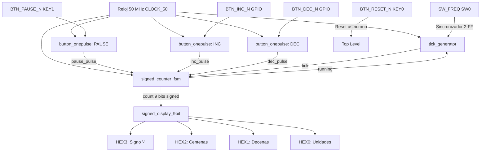
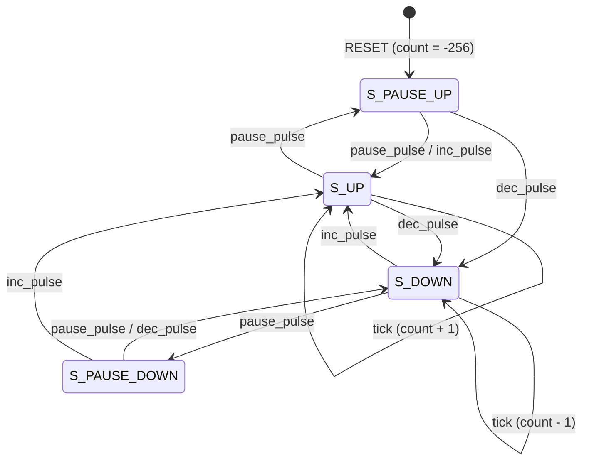

# Practica 3. Contador Ascendente–Descendente de 9 Bits con Signo (−256 a 255)

**Curso:** Sistemas Embebidos  
**Institución:** Universidad de las Américas Puebla (UDLAP)  
**Plataforma de destino:** FPGA Intel® MAX® 10 (Tarjeta Terasic DE10-Lite, `10M50DAF484C7G`)  
**Entorno de desarrollo:** Intel Quartus Prime Lite Edition / ModelSim / QuestaSim  
**Lenguaje:** Verilog HDL (IEEE 1364-2001)

---

## Descripción General

Este proyecto implementa en Verilog un sistema digital sincrónico completo de un **contador ascendente–descendente de 9 bits con signo** que opera en el rango completo de la representación en **complemento a dos** ($[-256, 255]$).

El sistema opera bajo un **único dominio de reloj** ($50\text{ MHz}$), evitando la generación de relojes derivados y garantizando máxima estabilidad y compatibilidad con las herramientas de síntesis estática de temporización (STA). Integra controles de reinicio asíncrono, pausa, cambio de sentido (ascendente/descendente), selección de velocidad ($1\text{ s}$ o $100\text{ ms}$ / variable), acondicionamiento antirrebote de botones y visualización decimal con signo y supresión de ceros no significativos en cuatro displays de 7 segmentos.

---

## Arquitectura del Sistema

El diseño se compone de una unidad de control y una ruta de datos desacopladas en módulos jerárquicos:

---

## Estructura de Archivos

| Archivo | Rol en el Diseño | Descripción |
| :--- | :--- | :--- |
| [`counter_9bit_top.v`](./counter_9bit_top.v) | **Top-Level Module** | Conecta e interconecta todos los módulos del sistema con los pines físicos de la FPGA DE10-Lite. |
| [`signed_counter_fsm.v`](./signed_counter_fsm.v) | **FSM y Contador** | Máquina de estados de 4 estados para control de sentido y pausa, junto al acumulador con signo en complemento a dos. |
| [`signed_display_9bit.v`](./signed_display_9bit.v) | **Decodificador y Display** | Conversor de complemento a dos a BCD usando el algoritmo **Double Dabble** (Shift-and-Add-3) y decodificador 7 segmentos con supresión de ceros a la izquierda. |
| [`tick_generator.v`](./tick_generator.v) | **Generador de Habilitación** | Divisor de frecuencia que produce pulsos `tick` de un ciclo para controlar el ritmo de actualización sin crear dominios de reloj secundarios. |
| [`button_onepulse.v`](./button_onepulse.v) | **Antirrebote y One-Pulse** | Sincronizador de 2 etapas, filtro antirrebote de $10\text{ ms}$ ($500{,}000$ ciclos a $50\text{ MHz}$) y detector de flanco descendente (botón activo en bajo). |
| [`tb_signed_counter.v`](./tb_signed_counter.v) | **Testbench** | Banco de pruebas para simular y validar las transiciones de la FSM, límites de desbordamiento (overflow/underflow) y persistencia en pausa. |

---

## ⚙️ Detalle de los Módulos

### 1. [`counter_9bit_top.v`](./counter_9bit_top.v) (Módulo Superior)
Instancia y sincroniza los bloques funcionales:
- **Puertos de entrada:**
  - `CLOCK_50`: Reloj maestro de $50\text{ MHz}$.
  - `BTN_RESET_N`: Pulsador activo en bajo para reinicio del sistema (mapeado a `KEY0`).
  - `BTN_PAUSE_N`: Pulsador activo en bajo para pausar/reanudar (mapeado a `KEY1`).
  - `BTN_INC_N`: Pulsador activo en bajo para modo ascendente (GPIO o interruptor).
  - `BTN_DEC_N`: Pulsador activo en bajo para modo descendente (GPIO o interruptor).
  - `SW_FREQ`: Interruptor deslizable para conmutar la tasa de conteo (mapeado a `SW0`).
- **Puertos de salida:**
  - `HEX0` a `HEX3`: Salidas de 7 segmentos activas en bajo ($0 = \text{encendido}$, $1 = \text{apagado}$).
- **Sincronización:** Implementa un sincronizador de dos flip-flops para la entrada asíncrona del interruptor `SW_FREQ` (`speed_meta` y `speed_sync`).

### 2. [`signed_counter_fsm.v`](./signed_counter_fsm.v) (FSM y Datapath)
Implementa la lógica del contador en complemento a dos de 9 bits (rango decimal $-256$ a $+255$):
- **Representación:**
  - `MAX_VALUE = 9'sd255` (`0_1111_1111`)
  - `MIN_VALUE = 9'b1_0000_0000` ($-256$ en complemento a dos)
- **Aritmética modular en extremos:**
  $$\text{Ascendente: } 255 + 1 \longrightarrow -256$$
  $$\text{Descendente: } -256 - 1 \longrightarrow 255$$
- **Codificación de Estados (2 bits al 100% de uso):**
  - `S_PAUSE_UP` (`2'd0`): Pausado; al recibir `pause_pulse`, reanuda en sentido ascendente.
  - `S_UP` (`2'd1`): Conteo ascendente activo ante cada `tick`.
  - `S_DOWN` (`2'd2`): Conteo descendente activo ante cada `tick`.
  - `S_PAUSE_DOWN` (`2'd3`): Pausado; al recibir `pause_pulse`, reanuda en sentido descendente.

### 3. [`signed_display_9bit.v`](./signed_display_9bit.v) (Conversión y Visualización)
- **Cálculo de Magnitud:** Extrae el valor absoluto del dato en complemento a dos:
  $$\text{magnitude} = \begin{cases} (\sim\text{value}) + 1 & \text{si } \text{value}[8] = 1 \\ \text{value} & \text{si } \text{value}[8] = 0 \end{cases}$$
- **Algoritmo Double Dabble (Shift-and-Add-3):** Convierte el valor binario de 9 bits a 3 dígitos BCD (centenas, decenas y unidades) en hardware combinacional sin requerir bloques divisores complejos ni costosos multiplicadores.
- **Supresión de ceros a la izquierda:**
  - `HEX0`: Muestra siempre las unidades.
  - `HEX1`: Muestra decenas únicamente si $\text{magnitude} \ge 10$; de lo contrario se apaga (`SEG_BLANK = 7'b1111111`).
  - `HEX2`: Muestra centenas únicamente si $\text{magnitude} \ge 100$; de lo contrario se apaga.
  - `HEX3`: Muestra el signo menos (`SEG_MINUS = 7'b0111111`) si el bit de signo `value[8]` es $1$; si es no negativo, se apaga.

### 4. [`tick_generator.v`](./tick_generator.v) (Habilitador de Paso de Tiempo)
- Genera un pulso `tick` activo durante un único ciclo de reloj cada $N$ ciclos de `CLOCK_50`:
  - **$1\text{ s}$:** Cuenta hasta $49{,}999{,}999$ ciclos ($50\text{ MHz} \times 1\text{ s}$).
  - **Velocidad rápida:** Configurado con límite terminal para refresco acelerado ($16{,}666{,}663$ ciclos $\approx 3\text{ Hz}$ / configurable a $4{,}999{,}999$ para $100\text{ ms}$).
- Se reinicia cuando `enable = 0` (modo pausa), garantizando que al reanudar el conteo siempre transcurra un período completo antes del primer incremento/decremento.

### 5. [`button_onepulse.v`](./button_onepulse.v) (Acondicionamiento)
- **Etapa 1:** Sincronizador de 2 flip-flops para mitigar metaestabilidad.
- **Etapa 2:** Contador temporizador de $10\text{ ms}$ ($499{,}999$ ciclos a $50\text{ MHz}$) que valida que la señal sea estable.
- **Etapa 3:** Genera un único pulso de un ciclo (`press_pulse = 1'b1`) únicamente al confirmar la transición de reposo ($1$) a presionado ($0$).

---

## Asignación de Pines para DE10-Lite

| Señal Top-Level | Pin Físico FPGA | Recurso DE10-Lite | Función |
| :--- | :--- | :--- | :--- |
| `CLOCK_50` | `PIN_P11` | 50 MHz Oscillator | Reloj principal del sistema |
| `BTN_RESET_N` | `PIN_B8` | `KEY0` (Pulsador) | Reinicio maestro (activo en bajo) |
| `BTN_PAUSE_N` | `PIN_A7` | `KEY1` (Pulsador) | Pausar / Reanudar conteo (activo en bajo) |
| `BTN_INC_N` | Pin GPIO / `SW1` | Entrada externa / Switch | Habilita conteo ascendente |
| `BTN_DEC_N` | Pin GPIO / `SW2` | Entrada externa / Switch | Habilita conteo descendente |
| `SW_FREQ` | `PIN_C10` | `SW0` (Switch) | `0`: Velocidad lenta ($1\text{ s}$), `1`: Rápida |
| `HEX0[6:0]` | `PIN_C14` .. `PIN_C17` | `HEX0` (7-Seg) | Unidades decimales (ánodo común / activo bajo) |
| `HEX1[6:0]` | `PIN_C18` .. `PIN_B22` | `HEX1` (7-Seg) | Decenas decimales (con supresión de ceros) |
| `HEX2[6:0]` | `PIN_B20` .. `PIN_A21` | `HEX2` (7-Seg) | Centenas decimales (con supresión de ceros) |
| `HEX3[6:0]` | `PIN_F21` .. `PIN_F17` | `HEX3` (7-Seg) | Signo negativo (segmento G activo cuando `value < 0`) |

---

## Simulación y Banco de Pruebas

El archivo [`tb_signed_counter.v`](./tb_signed_counter.v) implementa la secuencia completa de validación funcional basada en la guía de laboratorio:

| Paso | Valor Inicial | Evento / Estímulo | Valor Esperado | Estado Esperado | Caso de Prueba |
| :---: | :---: | :---: | :---: | :---: | :--- |
| **1** | Indefinido | `RESET` | `MIN_VALUE` / `0` | `S_PAUSE_UP` | Inicialización del sistema |
| **2** | $0$ | `INC` + `tick` | $+1$ | `S_UP` | Inicio de conteo ascendente |
| **3** | $+58$ | `tick` | $+59$ | `S_UP` | Incremento unitario regular |
| **4** | $+255$ | `tick` | $\mathbf{-256}$ | `S_UP` | **Desbordamiento superior (Overflow modular)** |
| **5** | $0$ | `DEC` + `tick` | $-1$ | `S_DOWN` | Inicio de conteo descendente |
| **6** | $-58$ | `tick` | $-59$ | `S_DOWN` | Decremento unitario regular |
| **7** | $-256$ | `tick` | $\mathbf{+255}$ | `S_DOWN` | **Desbordamiento inferior (Underflow modular)** |
| **8** | $+45$ | `PAUSA` + múltiples ticks | $+45$ | `S_PAUSE_UP` | Inmunidad a pulsos de reloj en pausa |
| **9** | $-123$ | `RESET` | `MIN_VALUE` / `0` | `S_PAUSE_UP` | Reinicio desde valor negativo |

---

## Flujo de Compilación y Programación en Quartus Prime

1. **Creación del Proyecto:**
   - Abrir Intel Quartus Prime y crear un nuevo proyecto apuntando al dispositivo **10M50DAF484C7G** (o la familia MAX 10 correspondiente a la tarjeta DE10-Lite).
2. **Agregar Archivos de Código:**
   - Añadir todos los archivos `.v` del directorio (`counter_9bit_top.v`, `signed_counter_fsm.v`, `signed_display_9bit.v`, `tick_generator.v`, `button_onepulse.v`).
   - Establecer `counter_9bit_top` como **Top-Level Entity** (`Project -> Set as Top-Level Entity`).
3. **Asignación de Pines:**
   - Utilizar el *Assignment Editor* o importar el archivo de restricciones `.qsf` con los pines listados en la tabla de asignación.
4. **Síntesis y Compilación:**
   - Ejecutar **Compile Design** (`Ctrl + L`). Asegurarse de que no existan errores de sintaxis y revisar el *Compilation Report* para verificar el uso de Logic Elements (LEs).
5. **Programación:**
   - Abrir el **Programmer** de Quartus.
   - Seleccionar el hardware **USB-Blaster**.
   - Cargar el archivo binario generado `counter_9bit_top.sof` y presionar **Start**.

## Videos de Pruebas

